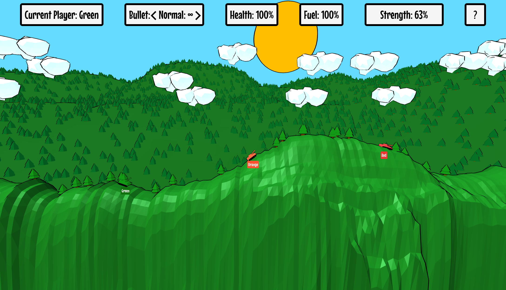

# Tank Game

A simple 2D tank game (with 3D graphics) written in Kotlin/JS using three.js.
The players take turns shooting each other with various bullet types in a destructable environment
until only one player is left.

## Screenshot

## Features
Game modes:
- Local multiplayer where the players simply take turns.
- Online multiplayer using a classical Client-Server Architecture implemented with Ktor

Bullet Types:
- *Normal*: A regular sized bullet.
- *Big*: A bigger bullet that does much more damage but cannot fly as far.
- *Zero Gravity*: A bullet that is not affected by gravity.
- *Teleport*: A bullet that does no damage at all but teleports the player to the impact position.

## Attributions
As you can see in the age of most of the commits, this project was entirely built in a pre-AI-Agents and
is therefore 100% human-made.

The project structure is based on this project template: [kotlin-three-js-starter](https://github.com/liorgonnen/kotlin-three-js-starter).
